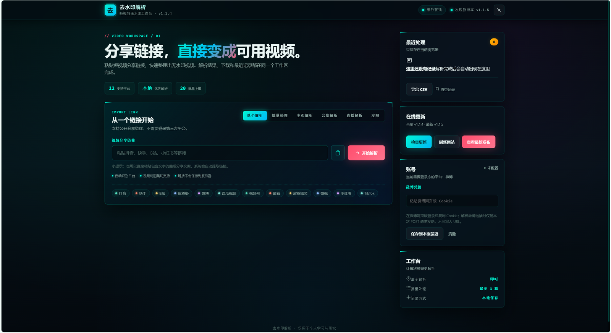
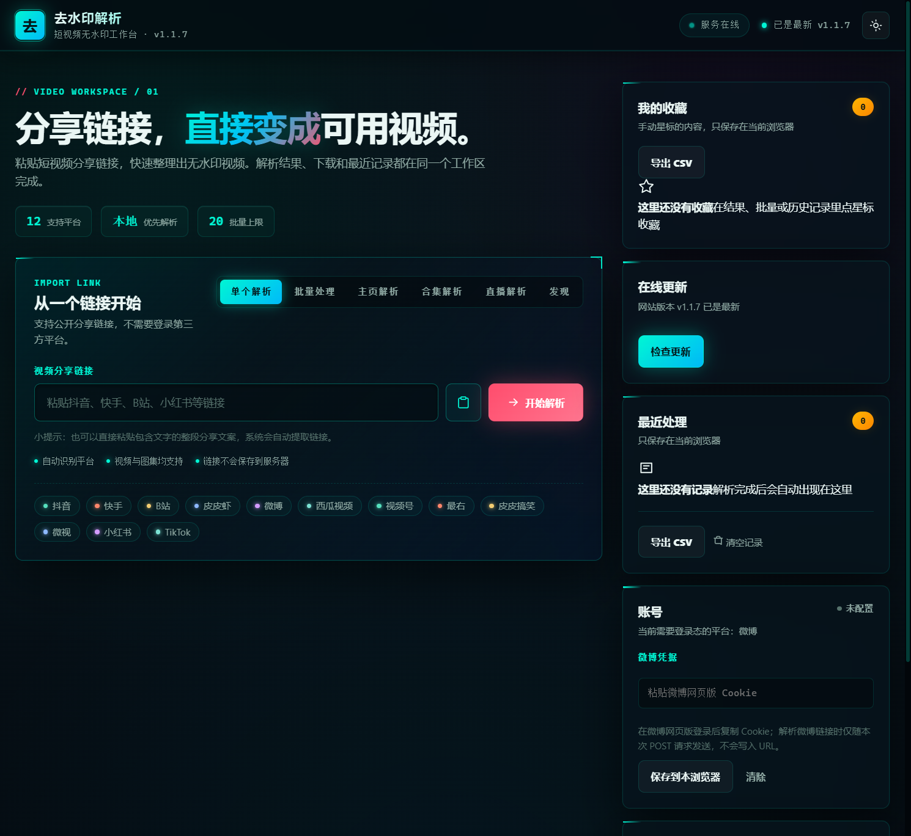
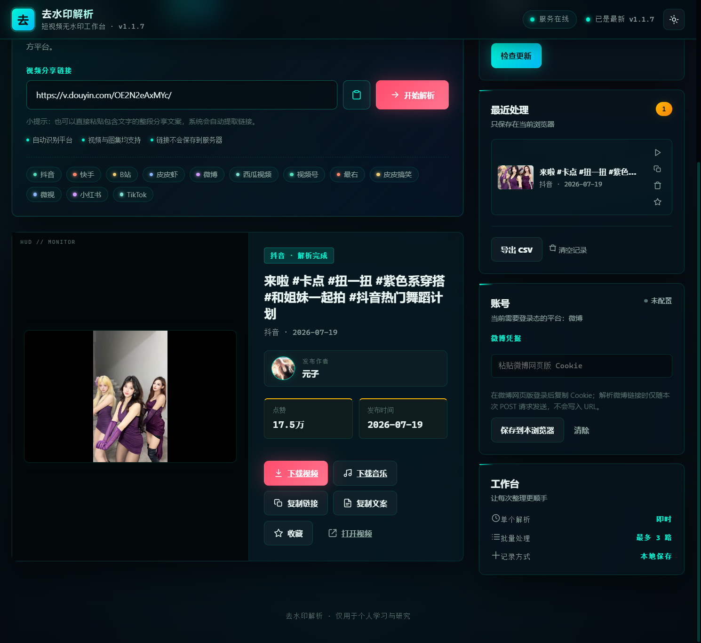
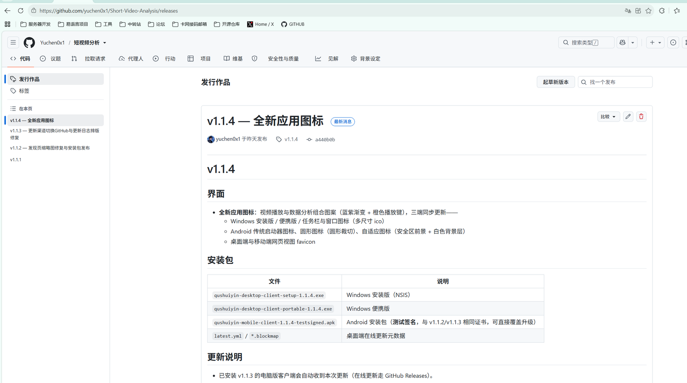

<div align="center">


# 短视频去水印解析工具

**粘贴一条分享链接，还你一份干净的无水印视频。**

覆盖 12 个主流短视频平台，一次解析视频、图集、封面与作者信息，提供网页版、电脑版、Android 端与版本化 HTTP API。

[](https://github.com/yuchen0x1/Short-Video-Analysis/releases/latest) [](#覆盖平台) [](#技术选型与环境要求) [](LICENSE)



**[⬇ 下载最新版本](https://github.com/yuchen0x1/Short-Video-Analysis/releases/latest)** ｜ [更新日志](CHANGELOG.md) ｜ [API 手册](#api-手册) ｜ [答疑与排障](#答疑与排障)

</div>

---

## 最新更新

### v1.1.9 · 2026-11-13

- 网页版新增历史与收藏搜索、JSON 备份与合并恢复；导入校验失败不会覆盖已有资料。
- 批量解析与重试共用运行状态，停止后可继续失败/停止项；修复「全部打包 ZIP」点击错误，并限制打包大小和并发。
- 旧版解析入口补齐 API Key 校验，微博解析隔离账号缓存，CSV 导出防止外部标题被直接识别为公式。
- 修正缓存路径越出项目目录、浅色模式输入面板对比度及手机端模式按钮换行。

[完整发布历史](docs/releases/release-notes.md) · [本轮分析与验收报告](docs/EVOLUTION-2026-11-13.md)

## 推广介绍图

> **粘贴分享链接，直接变成可用视频。**
>
> 去水印解析是一套本地优先的短视频工作台：自动识别平台，解析视频、图集、封面和音乐，并在同一工作区完成播放、下载、复制、收藏与历史管理。支持网页版、Windows 电脑版、Android 客户端和版本化 HTTP API。

<p align="center">
  
</p>

<p align="center">
  
</p>

## 目录

- 推广介绍图
- 界面预览
- 项目定位
- 功能全景
- 覆盖平台
- 技术选型与环境要求
- 获取代码
- 运行方式
- 使用指引
- API 手册
- 配置手册
- 开发、测试与发布
- 目录结构
- 答疑与排障
- 安全设计
- Star History
- 参与贡献
- 协议与声明

## 界面预览

网页版、电脑版与 Android 端共享同一套解析能力与工作台式界面：粘贴分享文案后自动提取链接，解析结果、下载与最近记录在同一个工作区内完成。

推广截图已在上方「推广介绍图」集中展示。

所有版本统一通过 GitHub Releases 发布，客户端内置在线更新：



## 项目定位

一套可自托管的短视频解析工具箱，由四个部分组成：

- **根目录 PHP 应用**：提供网页版界面、媒体代理和 `/api/v1` 版本化 API。
- **`apps/app-shell`**：Electron 电脑版客户端，在本机使用共享 JS 解析器完成解析。
- **`apps/mobile`**：Capacitor Android 移动端客户端，同样使用共享 JS 解析器，并带 Android 原生下载桥。
- **`packages/parsers`**：平台无关的 JS 解析器包，供桌面端和移动端复用。

目前已接入 12 个平台的平台识别与解析入口。部分平台的可用性取决于公开接口状态、分享链接类型或登录 Cookie，平台接口变更后可能需要同步修复解析器。

## 功能全景

- **单条解析** —— 从分享文案中提取 URL，解析标题、作者、封面、无水印媒体地址等字段。
- **图集解析** —— 解析器返回 `media_type=image` 时给出 `images` 图片数组，支持逐张下载。
- **音乐下载** —— 抖音等平台解析出背景音乐播放地址时，网页版、电脑版与手机版都会提供「下载音乐」入口。
- **批量解析** —— 网页版每行一个链接，单次最多 20 条；成功项可一键全部打包 ZIP（媒体总大小最多 128 MiB，逐个下载、单文件请求最多 60 秒），失败或停止项可一键重试。页面刷新后批量队列不会保留。
- **主页解析** —— `/api/v1/profile` 与客户端支持抖音公开主页分页解析；必须使用明确的抖音主页链接，不支持短链主页。
- **合集解析** —— `/api/v1/collection` 与客户端支持抖音合集分页解析，返回合集标题、作者与逐页作品列表；网页版、电脑版与手机版均支持「加载全部 + 全部下载」。
- **直播解析** —— `/api/v1/live` 支持抖音直播（live.douyin.com）、B站直播（live.bilibili.com）、虎牙直播（huya.com/房间号）与斗鱼直播（douyu.com/房间号）直播间解析，返回主播、标题、人气与拉流地址列表；虎牙下发 FLV 原画（按 CDN 线去重），斗鱼下发 FLV 多画质（原画2K60/蓝光8M/蓝光4M/超清/高清），支持用 VLC、PotPlayer、IINA 等播放器打开。
- **发现（热榜/搜索）** —— `/api/v1/hot` 支持抖音热点榜与 B站综合热门；`/api/v1/search` 支持 B站与抖音关键词搜索。合规边界：仅响应用户主动查询、按需分页、不落库。
- **公开评论** —— `/api/v1/comments` 支持 B站单视频公开评论查看（按需分页，仅查看不保存）。
- **CSV 导出** —— 网页版支持导出最近记录、我的收藏、批量结果与主页/合集列表为 CSV（UTF-8 BOM，Excel 可直接打开）。
- **资料管理（网页版）** —— 按标题、作者或链接搜索历史和收藏；导出/导入版本化 JSON 备份，按原始分享链接合并去重，保留已有同链接记录，不导出 Cookie。单文件上限 4 MiB，每类最多 2000 条；旧数据首次写入时迁移，旧存储键保留。CSV 用于查看，JSON 用于恢复。
- **收藏夹** —— 网页版可在解析结果、批量结果与历史记录中星标收藏，保存在当前浏览器，支持一键重新解析与导出 CSV。
- **HLS 支持** —— 媒体代理对 m3u8 播放列表自动改写，分片/子列表/密钥 URI 全部经由代理转发（注入 Referer/UA 并逐跳校验），带防盗链的 HLS 流（如 B站直播）可直接打开播放。
- **历史记录** —— 网页版默认保留最近 20 条（导入更多历史后保留该容量，最多 2000 条），移动端保存最近 20 条，桌面端保存最近 100 条，均为本地浏览器/客户端存储。
- **媒体代理** —— PHP、Electron、Android 三端均提供本地或服务端媒体代理，注入 Referer/UA 并支持 Range 播放。
- **API 鉴权** —— `API_KEY_ENABLED=true` 后，除 `/api/v1/health` 外的接口均需 API Key；旧版 `/?url=...`、`/index.php?url=...` 和媒体代理同样校验。网页外壳仍可打开，内置网页尚无 API Key 登录界面。
- **限流与缓存** —— 基于 Symfony Cache / RateLimiter，默认文件缓存，可切换 Redis。微博结果不进入解析缓存；缓存文件位于本项目 `storage/cache`，旧父目录缓存不再读取，且不会自动删除。
- **自动更新** —— 网站、Android 与 Windows 客户端默认检查 GitHub 最新 Release；Windows Electron 客户端自动下载并支持重启安装。
- **PWA 安装** —— 网页版提供 Web App Manifest 与 Service Worker，支持安装到桌面/主屏并离线打开页面壳；全局快捷键 `Ctrl/Cmd+Enter` 触发解析、`Ctrl/Cmd+K` 聚焦输入框，主题可跟随系统明暗切换。

## 覆盖平台

**主流平台**

- **抖音**：`douyin.com`、`v.douyin.com` —— PHP Web/API 依赖本地 `a_bogus` 签名服务；桌面端和移动端使用 JS 本地签名。
- **快手**：`kuaishou.com`、`kuaishou.cn` —— 支持单条解析。
- **B站**：`bilibili.com`、`b23.tv` —— 支持单条解析。
- **小红书**：`xiaohongshu.com`、`xhslink.com` —— 支持视频与图文图集解析。
- **微博**：`weibo.com` —— 需要有效微博 Cookie；桌面端可通过内置微博网页登录态辅助解析。

**其他平台**

- **皮皮虾**：`pipix.com` —— 支持视频和图集。
- **微视**：`weishi.qq.com` —— 支持单条解析。
- **最右**：`izuiyou.com` —— 支持单条解析。
- **皮皮搞笑**：`ippzone.com`、`pipigx.com` —— 支持单条解析。
- **视频号**：`channels.weixin.qq.com` —— 支持单条解析。
- **西瓜视频**：`ixigua.com` —— 支持单条解析。
- **TikTok 国际版**：`tiktok.com`、`vm.tiktok.com`、`vt.tiktok.com` —— 支持视频与图集解析，无需登录；TikTok 主页批量与直播暂不支持。部署环境需能访问 TikTok（国内网络需自备代理，不可达时接口会快速返回受控错误）。

## 技术选型与环境要求

### 技术选型

| 模块 | 技术 |
| --- | --- |
| 后端 / API | PHP 8.1+、Composer、Symfony Cache、Symfony RateLimiter、vlucas/phpdotenv |
| 网页版 | PHP 模板页面 + 原生 HTML/CSS/JavaScript |
| 电脑版 | Electron 44、Vite 7、electron-updater |
| 移动端 | Capacitor 7、Vite 7、Android 原生插件 |
| 共享解析器 | 原生 ES Modules，无运行时第三方依赖 |
| 测试 | PHPUnit 9.6、离线 JS parser 契约测试、仓库 smoke 检查 |

### 环境要求

- 网页版 / API：PHP 8.1+（启用 `curl`、`dom`、`json`、`mbstring`、`openssl` 扩展）、Composer、Node.js 18+。
- Docker 部署：Docker 与 Docker Compose。
- 电脑版开发 / 打包：Node.js 18+；Windows 打包使用 `electron-builder`。
- 移动端开发：Node.js 18+；Android 构建需要 JDK 21、Android SDK Platform 35、Build Tools 35（兼容补充 34）和 Gradle 8.11.1；SDK licenses 需要先接受。

> 提示：PHP 解析抖音依赖 `scripts/a_bogus_server.js` 提供签名服务。`composer serve:full`、`start.bat`、`start.sh` 与 Docker 都会自动把它拉起来。

## 获取代码

```bash
git clone https://github.com/yuchen0x1/Short-Video-Analysis.git
```

## 运行方式

下面给出四种常见跑法，按需选择其一即可。

### 方式一：本地跑网页版与 API

```bash
composer install
composer serve:full
```

然后打开 <http://127.0.0.1:18180> 即可使用。

只启动 PHP 服务、不自动启动抖音签名服务：

```bash
composer serve
```

Windows 与 Linux/macOS 也可以分别运行启动脚本：

```bash
start.bat
./start.sh
```

两个脚本会从 `APP_PORT=18180` 和 `A_BOGUS_PORT=9876` 开始寻找空闲端口，并启动 PHP 内置服务器。

### 方式二：Docker 一键部署

```bash
docker compose up -d
```

默认访问地址 <http://127.0.0.1:18180>。如需更换宿主机端口：

```bash
APP_PORT=18080 docker compose up -d
```

容器内监听 `8000`，入口脚本会同时启动 `a_bogus` 签名服务。

### 方式三：电脑版（Electron）

直接启动：

```bash
cd apps/app-shell
npm install
npm run desktop
```

开发模式（Vite 页面 + Electron 壳）：

```powershell
cd apps/app-shell
npm install
npm run dev
$env:APP_DEV_SERVER_URL="http://127.0.0.1:5173"
npm run desktop:dev
```

打包 Windows 安装版和便携版：

```bash
cd apps/app-shell
npm install
npm run dist:win
```

产物输出到 `apps/app-shell/release/`。电脑版使用共享 JS 解析器和主进程网络桥，不需要运行根目录 PHP 服务。

### 方式四：Android 客户端（Capacitor）

```bash
cd apps/mobile
npm install
npm run mobile:sync
```

本地验证 Debug 构建和 JVM 单元测试：

```powershell
Push-Location android
.\gradlew.bat :app:assembleDebug :app:testDebugUnitTest
Pop-Location
```

打开 Android 工程：

```bash
npm run mobile:android
```

如果 `android/` 工程不存在，再执行：

```bash
npm run mobile:add:android
```

当前仓库已包含 `apps/mobile/android/`。Android 端使用共享 JS 解析器、CapacitorHttp、原生本地媒体代理和 DownloadManager 下载桥，不需要运行根目录 PHP 服务。

## 使用指引

### 网页版

1. 打开首页，粘贴短视频分享文案或纯链接；
2. 点击「开始解析」或按回车；
3. 解析成功后，可播放、下载、复制无水印链接或打开原链接；
4. 切换到「批量处理」，每行提交一个链接，单次最多 20 条；
5. 切换到「主页解析」，提交明确的抖音主页链接，按页浏览公开作品；
6. 切换到「合集解析」，提交抖音合集链接，支持「加载全部」后整组合集下载。

### 电脑版与 Android 端

1. 直接粘贴分享文案或链接；
2. 「主页」模式仅支持抖音公开主页分页；「合集」模式支持抖音合集分页，两者均支持全量加载与批量下载；
3. 「发现」页查看 B站热门 / 抖音热点榜，或关键词搜索 B站、抖音视频，条目可一键解析；
4. B站视频解析结果提供「查看评论」入口（电脑版）；
5. 微博解析失败时，在「关于」页配置微博 Cookie；电脑版还可使用内置微博网页登录。

## API 手册

OpenAPI 定义位于 [`public/openapi.yaml`](public/openapi.yaml)，base path 为 `/api/v1`。

| 接口 | 方法 | 用途 |
| --- | --- | --- |
| `/api/v1/health` | GET | 健康检查，始终公开。 |
| `/api/v1/platforms` | GET | 返回支持的平台 key 列表。 |
| `/api/v1/parse?url=...` | GET | 解析单条链接。 |
| `/api/v1/parse` | POST | 从 JSON 或表单 body 解析单条链接。 |
| `/api/v1/profile` | GET/POST | 抖音公开主页单页作品解析。 |
| `/api/v1/collection` | GET/POST | 抖音合集单页作品解析。 |
| `/api/v1/live` | GET/POST | 直播间解析（抖音直播、B站直播、虎牙直播、斗鱼直播）。 |
| `/api/v1/hot` | GET | 平台公开热榜（B站热门、抖音热点榜）。 |
| `/api/v1/search` | GET | 关键词搜索公开视频（B站、抖音）。 |
| `/api/v1/comments` | GET | 单视频公开评论（仅 B站，按需分页）。 |
| `/api/v1/update` | GET | 在线更新检查（读取 GitHub 最新 Release）。 |

开启 API Key 后，除 `/api/v1/health` 和 `/api/v1/update` 外的请求需携带以下任一请求头：

```text
X-API-Key: <key>
Authorization: Bearer <key>
```

### 解析请求示例

```bash
curl -X POST "http://127.0.0.1:18180/api/v1/parse" \
  -H "Content-Type: application/json" \
  -d '{"url":"https://v.douyin.com/iAbCdEf/"}'
```

成功响应结构：

```json
{
  "success": true,
  "message": "解析成功",
  "request_id": "10ad6482aced9e5d902a5b5f",
  "data": {
    "platform": "douyin",
    "title": "视频标题文案",
    "author": "作者昵称",
    "uid": "作者ID",
    "avatar": "https://example.com/avatar.jpg",
    "like": 12345,
    "time": 1724630400,
    "cover": "https://example.com/cover.jpg",
    "url": "https://example.com/no-watermark.mp4",
    "music": { "author": "音乐作者", "avatar": "https://example.com/music.jpg" },
    "media_type": "video",
    "images": []
  }
}
```

图集作品返回 `media_type: "image"`，`images` 为图片地址数组，`url` 通常取第一张图。

单条解析结果固定包含 `platform`、`media_type`、`images`、`music` 四个字段（与桌面/移动端 JS 解析器一致）。媒体直链带时效，失效后可加 `force=1` 跳过缓存重新获取：

```bash
curl "http://127.0.0.1:18180/api/v1/parse?url=https%3A%2F%2Fv.douyin.com%2Fxxxx&force=1"
```

### 抖音主页解析示例

```bash
curl -X POST "http://127.0.0.1:18180/api/v1/profile" \
  -H "Content-Type: application/json" \
  -d '{"url":"https://www.douyin.com/user/MS4wLjABAAAAxxxx","cursor":0}'
```

响应 `data` 包含 `profile`、`items`、`has_more`、`next_cursor`、`cursor` 和 `page_size`。请求下一页时，把上一页返回的 `next_cursor` 作为 `cursor` 传入。

### 抖音合集解析示例

```bash
curl -X POST "http://127.0.0.1:18180/api/v1/collection" \
  -H "Content-Type: application/json" \
  -d '{"url":"https://www.douyin.com/collection/7190000000000000000","cursor":0}'
```

响应 `data` 包含 `collection`（`mix_id`、`title`、`author`、`avatar`、`desc`、`total`）、`items`、`has_more`、`next_cursor`、`cursor` 和 `page_size`。请求下一页时，把上一页返回的 `next_cursor` 作为 `cursor` 传入。

### 直播解析示例

```bash
curl -X POST "http://127.0.0.1:18180/api/v1/live" \
  -H "Content-Type: application/json" \
  -d '{"url":"https://live.bilibili.com/6"}'
```

响应 `data` 包含 `platform`、`live`（`room_id`、`title`、`anchor`、`avatar`、`cover`、`viewers`、`status`，`status` 为 `live` 或 `offline`）与 `streams` 拉流地址数组（每项含 `format`（`flv`/`hls`）、`quality`、`url`）。未开播时 `streams` 为空数组。

### 健康检查示例

```bash
curl "http://127.0.0.1:18180/api/v1/health"
```

响应包含 `status`、`version`、`php_version`、`ready`、`dependencies`、`sidecar`、`warnings` 和 `timestamp`。`dependencies` 覆盖 `curl`/`json`/`openssl`/`mbstring`/`dom`；`sidecar.reachable` 表示本地 a_bogus 签名服务是否可达，未启动时 `status` 为 `degraded` 并在 `warnings` 说明受影响的抖音功能，但不影响其他平台解析。

### 热榜与搜索示例

```bash
curl "http://127.0.0.1:18180/api/v1/hot?platform=bilibili&page=1"
curl "http://127.0.0.1:18180/api/v1/search?platform=bilibili&keyword=%E5%93%94%E5%93%A9%E5%93%94%E5%93%A9&page=1"
curl "http://127.0.0.1:18180/api/v1/comments?url=https%3A%2F%2Fwww.bilibili.com%2Fvideo%2FBV1GJ411x7h7&page=1"
```

响应 `data` 包含 `platform`、`items`（`title`/`url`/`cover`/`author`/`hot`）、`has_more` 与 `next_page`；评论接口额外返回 `total`、`comments`（`user`/`content`/`likes`/`time`）。抖音热榜条目为热点词（指向抖音搜索页），不支持直接解析；抖音搜索走网页公开接口（受风控时返回受控错误），评论仅支持 B站。

### 媒体代理入口

```text
GET /index.php?action=media&url=<encoded-media-url>&download=1&filename=video.mp4
```

代理的行为：校验 URL 只允许 `http`/`https`；拒绝 localhost、环回地址、私有地址和保留地址；默认按 `MEDIA_PROXY_ALLOWED_DOMAINS` 白名单放行媒体域名；对每一次重定向重新校验目标 URL 和解析后的 IP；注入 Referer/UA、透传 Range 请求并限制单次转发大小；m3u8 播放列表自动改写，分片、子播放列表与密钥 URI 均经由代理逐跳校验转发；`API_KEY_ENABLED=true` 时同样校验媒体代理请求。安全细节见下文「安全设计」。

## 配置手册

复制 `.env.example` 为 `.env` 后按需修改：

```bash
cp .env.example .env
```

**基础配置**

| 变量 | 默认值 | 说明 |
| --- | --- | --- |
| `APP_NAME` | `Short Video No-Watermark Downloader` | 应用名。 |
| `APP_DEBUG` | `false` | 是否启用调试模式。 |
| `APP_CORS_ALLOW_ORIGIN` | `*` | API 和页面响应的 CORS Origin。 |
| `APP_ENV` | `production` | 运行环境标识。 |
| `APP_PORT` | `18180` | 本地启动脚本和 Docker 宿主机端口。 |

**限流配置**

| 变量 | 默认值 | 说明 |
| --- | --- | --- |
| `RATE_LIMIT_ENABLED` | `true` | 是否启用解析和媒体代理限流。 |
| `RATE_LIMIT_MAX_REQUESTS` | `60` | API 默认时间窗口内最大请求数。 |
| `RATE_LIMIT_TIME_WINDOW` | `60` | 限流窗口秒数。 |
| `RATE_LIMIT_TRUST_PROXY_HEADERS` | `false` | 仅在可信反向代理后启用，用 `X-Forwarded-For` / `X-Real-IP` 取客户端 IP。 |
| `RATE_LIMIT_FAIL_OPEN` | `false` | 限流存储异常时是否放行。默认失败关闭。 |
| `RATE_LIMIT_MEDIA_MAX_REQUESTS` | `120` | 媒体代理独立请求上限，复用限流窗口。 |

**网络请求**

| 变量 | 默认值 | 说明 |
| --- | --- | --- |
| `CURL_CONNECT_TIMEOUT` | `5` | cURL 连接超时秒数。 |
| `CURL_TIMEOUT` | `10` | cURL 总超时秒数。 |
| `CURL_MAX_RETRIES` | `3` | 网络错误或 5xx 响应重试次数。 |
| `CURL_CA_BUNDLE` | `storage/certs/cacert.pem` | 可选 CA 文件路径，Windows PHP 未配置 CA 时可设置绝对路径。 |

**签名与 Cookie**

| 变量 | 默认值 | 说明 |
| --- | --- | --- |
| `A_BOGUS_PORT` | `9876` | PHP 抖音解析使用的本地签名服务端口。 |
| `WEIBO_COOKIE` | 空 | 服务端微博解析 Cookie。也可在网页版请求中临时传 `weiboCookie`。 |

**缓存与 Redis**

| 变量 | 默认值 | 说明 |
| --- | --- | --- |
| `PARSE_CACHE_ENABLED` | `true` | 是否启用解析结果缓存。 |
| `PARSE_CACHE_TTL` | `86400` | 解析缓存 TTL 秒数。 |
| `PARSE_CACHE_DRIVER` | `file` | 解析缓存驱动：`file`、`redis` 或 `array`。 |
| `RATE_LIMIT_CACHE_ENABLED` | `true` | 是否启用限流持久化缓存。 |
| `RATE_LIMIT_CACHE_DRIVER` | `file` | 限流缓存驱动：`file` 或 `redis`。 |
| `REDIS_HOST` | `127.0.0.1` | Redis 主机，缓存驱动为 `redis` 时使用。 |
| `REDIS_PORT` | `6379` | Redis 端口。 |
| `REDIS_PASSWORD` | 空 | Redis 密码。 |
| `REDIS_DATABASE` | `0` | Redis 数据库编号。 |

**API 鉴权**

| 变量 | 默认值 | 说明 |
| --- | --- | --- |
| `API_KEY_ENABLED` | `false` | 是否开启 API Key 鉴权。 |
| `API_KEY` | 空 | API Key 值，建议使用强随机字符串。 |

**媒体代理**

| 变量 | 默认值 | 说明 |
| --- | --- | --- |
| `MEDIA_PROXY_ENABLED` | `true` | 是否启用网页版媒体代理。 |
| `MEDIA_PROXY_MAX_SIZE` | `524288000` | 媒体代理单次转发字节上限，默认 500MB。 |
| `MEDIA_PROXY_ALLOWED_DOMAINS` | 内置媒体域名列表 | 逗号分隔的媒体代理域名白名单。留空使用 `config/media_domains.php` 的内置列表（覆盖全部 12+4 平台 CDN），填写后整体覆盖内置列表。 |
| `MEDIA_PROXY_STRICT_MODE` | `true` | 白名单为空时是否失败关闭。 |
| `MAX_JSON_BODY_BYTES` | `1048576` | JSON 请求体上限，超出返回 413。 |
| `UPDATE_CACHE_TTL` | `900` | `/api/v1/update` 的服务端缓存秒数，避免反复消耗 GitHub 匿名配额；请求传 `force=1` 可绕过。 |

**日志**

| 变量 | 默认值 | 说明 |
| --- | --- | --- |
| `LOG_LEVEL` | `error` | 日志级别：`debug`、`info`、`warning`、`error`。 |
| `LOG_MAX_FILES` | `30` | 日志轮转保留文件数。 |

已废弃配置：`DOUYIN_NODE_BIN` 和 `DOUYIN_A_BOGUS_SCRIPT` 不再使用，PHP 抖音签名统一通过本地 HTTP 签名服务完成。

## 开发、测试与发布

### 日常自检

根目录 PHP 检查：

```bash
composer lint
composer test
composer smoke
```

共享 JS 解析器离线契约测试：

```bash
cd packages/parsers
npm test
```

更新检查器契约测试：

```bash
cd packages/update-checker
npm test
```

live 审计脚本需要真实网络和平台接口状态：

```bash
cd packages/parsers
npm run test:live
```

GitHub Actions 流水线 `.github/workflows/quality.yml` 在 push 到 `main`、推送 `v*` 标签和 Pull Request 时自动执行：PHP lint + PHPUnit + smoke、`packages/parsers` 与 `packages/update-checker` 契约测试、`scripts/a_bogus_server.test.mjs`、桌面端与移动端构建，以及仓库卫生检查（禁止跟踪 `.phpunit.result.cache`、`git diff --check`）。`.workflow/quality-pipeline.yml` 是早期 Gitee Go 流水线的历史配置，已不再使用。发布流程以「打包发布」章节为准。

### 打包发布

**Windows（Electron）**：本地构建执行 `cd apps/app-shell && npm install && npm run dist:win`，安装包、便携版与 `latest.yml` 生成于 `apps/app-shell/release/`，随后上传到 GitHub Release；客户端通过 GitHub Releases 在线更新通道自动检测新版本。

**Android**：签名说明见 [`apps/mobile/SIGNING.md`](apps/mobile/SIGNING.md)。构建前先同步 Web 资源：

```bash
cd apps/mobile
npm install
npm run mobile:sync
```

然后使用 Android Studio 或 `apps/mobile/android/gradlew` 构建 APK/AAB。

### 自动更新机制

自动更新、GitHub 标签发布、资产校验和签名限制见 [`docs/AUTO_UPDATE.md`](docs/AUTO_UPDATE.md)。正式版本使用 `vMAJOR.MINOR.PATCH` 标签触发 GitHub Actions；发布前必须先同步根目录、桌面端、移动端和 Android 的版本号。

各端统一使用 GitHub Releases 作为版本源：

- **网站**：访问 `/api/v1/update`，服务端读取 GitHub 最新 Release（REST API 主路径，API 限流时自动回退 `releases.atom` 与 expanded assets 页面）；页面启动时自动检查，也可手动检查并打开发布页下载。
- **Android**：启动时自动检查 GitHub Release，关于页可手动检查；发现 APK 后通过系统下载器下载。正式签名 APK 可用于升级，测试签名 APK 仅适合测试。
- **Windows 安装版**：由 `electron-updater` 读取 GitHub Release 的 `latest.yml`，启动后自动检查、下载并提示重启安装；关于页可手动检查。

发布新版本时，先同步根目录、`apps/app-shell`、`apps/mobile` 和 Android 的版本号，再推送 `vX.Y.Z` 标签；GitHub Actions 会自动构建并发布 Windows 安装包、便携版、`latest.yml`/blockmap 和 SHA-256 清单。Android 正式 APK 需要额外配置签名密钥后再上传。手机版可通过 `VITE_UPDATE_API_URL` 指向已部署的 `/api/v1/update` 自定义更新源。

版本变更记录见 [`CHANGELOG.md`](CHANGELOG.md)。

> **从 2.x 升级到 1.0.0**：项目自 1.0.0 起重置版本体系，1.0.0 低于旧版 2.4.0，旧客户端的自动更新不会推送此次变更。已安装 2.x 的用户请卸载后手动安装 1.0.0（Windows 覆盖安装、Android 需先卸载旧版，因 Android `versionCode` 已重置为 1）。此后版本号从 1.0.0 重新递增，自动更新恢复正常。

## 目录结构

```text
├── app/                  # PHP 解析核心、服务和工具类
│   ├── Parsers/          # PHP 平台解析器
│   ├── Services/         # 解析门面、缓存、限流、媒体代理
│   └── Utils/            # 配置、响应、HTTP、鉴权、日志、Cookie
├── public/               # 网页版入口、API v1、OpenAPI、路由脚本
├── config/               # 应用、缓存、Cookie 配置
├── assets/               # 应用图标与 README 截图资源
├── scripts/              # 抖音 a_bogus 签名服务和图标生成脚本
├── bin/                  # lint 和 smoke 检查脚本
├── tests/                # PHPUnit 单元和回归测试
├── packages/parsers/     # 共享 JS 解析器包
├── apps/app-shell/       # Electron 电脑版客户端
├── apps/mobile/          # Capacitor Android 移动端客户端
├── Dockerfile            # PHP API Docker 镜像
├── docker-compose.yml    # Docker Compose 开发/部署入口
└── CHANGELOG.md          # 更新日志
```

## 答疑与排障

**Q：抖音解析提示签名失败？**
A：确认 Node.js 18+ 可用，并使用 `composer serve:full`、启动脚本或 Docker 自动启动签名服务；手动部署时运行 `node scripts/a_bogus_server.js`。

**Q：`composer install` 后 PHP 请求失败？**
A：确认 PHP 启用了 `curl` 和 `json` 扩展；Windows 下可检查 `php.ini` 和 CA 证书配置。

**Q：HTTPS 上游请求证书失败？**
A：将 `CURL_CA_BUNDLE` 指向有效的 `cacert.pem` 绝对路径，仓库内置文件在 `storage/certs/cacert.pem`。

**Q：接口返回 429 请求过频？**
A：调整 `RATE_LIMIT_MAX_REQUESTS`、`RATE_LIMIT_TIME_WINDOW`，或媒体代理专用的 `RATE_LIMIT_MEDIA_MAX_REQUESTS`。

**Q：媒体无法播放或下载？**
A：确认媒体代理已开启；如使用自定义白名单，检查 `MEDIA_PROXY_ALLOWED_DOMAINS` 是否包含目标 CDN 域名。

**Q：微博解析失败？**
A：配置有效 `WEIBO_COOKIE`，或在网页/客户端「关于」区域配置 Cookie；电脑版优先使用内置微博网页登录态。

**Q：抖音主页解析失败？**
A：只支持明确的 `douyin.com/user/...` 或带 `sec_user_id` / `sec_uid` 的抖音主页链接，不支持短链主页。

**Q：抖音合集解析失败？**
A：只支持明确的 `douyin.com/collection/<mix_id>` 或带 `mix_id` 参数的抖音合集链接；合集可能已失效或接口暂时受限，可稍后重试。

**Q：Docker 健康检查失败？**
A：查看容器日志，确认容器内 `8000` 服务和 `a_bogus` 服务已启动。

**Q：可以直接部署到公网吗？**
A：可以，但建议至少开启 API Key，并根据业务流量调整限流。媒体代理默认有域名白名单、私网拦截和大小限制。

**Q：电脑版或 Android 端需要后端服务吗？**
A：不需要运行根目录 PHP 服务。它们使用 `packages/parsers` 的共享 JS 解析器，并通过 Electron 主进程或 Capacitor 原生网络层发起平台请求。

**Q：为什么同一个链接有时解析失败？**
A：平台接口、作品权限、地区、登录态和分享链接类型都会影响结果。先确认原链接可访问，再看是否需要 Cookie 或更新解析器。

**Q：为什么不保证所有平台永久可用？**
A：本项目依赖各平台公开页面和接口行为，平台接口变更后需要同步维护解析逻辑。

## 安全设计

- 媒体代理和下载桥只接受 `http` / `https` URL。
- PHP 媒体代理默认拒绝 localhost、环回、私有和保留地址，并对重定向逐跳校验。
- 生产环境建议开启 `API_KEY_ENABLED=true` 并设置强随机 `API_KEY`。
- 只有部署在可信反向代理之后，才应开启 `RATE_LIMIT_TRUST_PROXY_HEADERS=true`。
- `MEDIA_PROXY_STRICT_MODE=true` 时，如果白名单为空会失败关闭，避免把服务变成开放代理。
- 不要把个人微博 Cookie 提交到仓库；客户端保存的 Cookie 仅存在本机本地存储或 Electron 会话中。

## Star History

<a href="https://star-history.com/#yuchen0x1/Short-Video-Analysis&Date">
  <picture>
    <source media="(prefers-color-scheme: dark)" srcset="https://api.star-history.com/svg?repos=yuchen0x1/Short-Video-Analysis&type=Date&theme=dark" />
    <source media="(prefers-color-scheme: light)" srcset="https://api.star-history.com/svg?repos=yuchen0x1/Short-Video-Analysis&type=Date" />
    
  </picture>
</a>

## 参与贡献

1. 新增或修复解析器时，同时更新 PHP 解析器和共享 JS 解析器，或明确说明只影响某一端。
2. 修改平台字段结构时，同步检查 `public/openapi.yaml`、前端展示和 parser 契约测试。
3. 提交前运行 `composer lint`、`composer test`、`composer smoke`、`cd packages/parsers && npm test` 和 `cd packages/update-checker && npm test`。
4. 不要提交 `.env`、Cookie、真实 API Key、签名密钥或本地打包产物。

## 协议与声明

本项目基于开源项目 `5ime/video_spider` 二次开发，并按 [`AGPL-3.0-only`](LICENSE) 授权。公开部署、修改发布或再次分发时，请同时遵守 AGPL-3.0 的源代码开放要求和原项目相关声明。

本项目仅供个人学习与研究使用。请遵守目标平台服务条款和所在地法律法规，不要将本项目用于侵犯他人权益或未经授权的内容分发。
